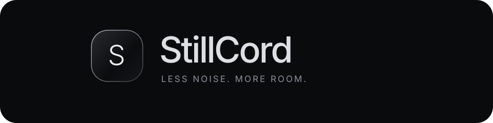
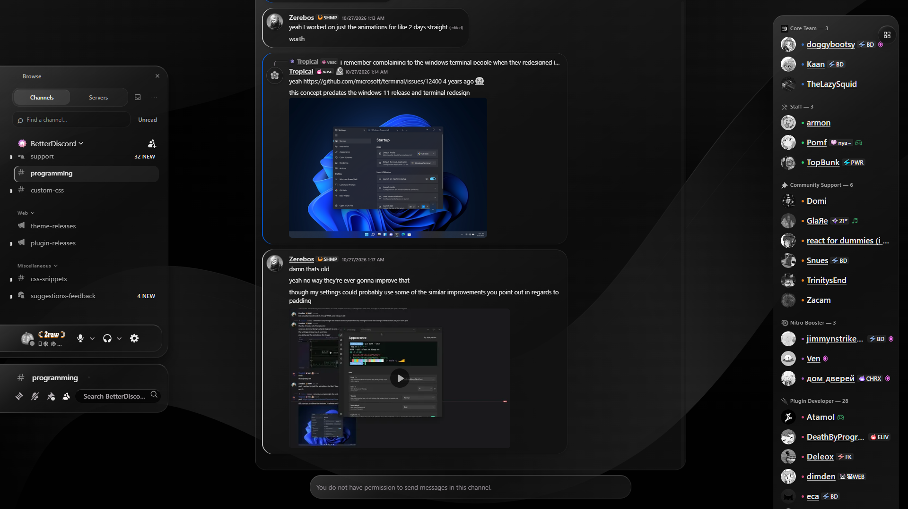
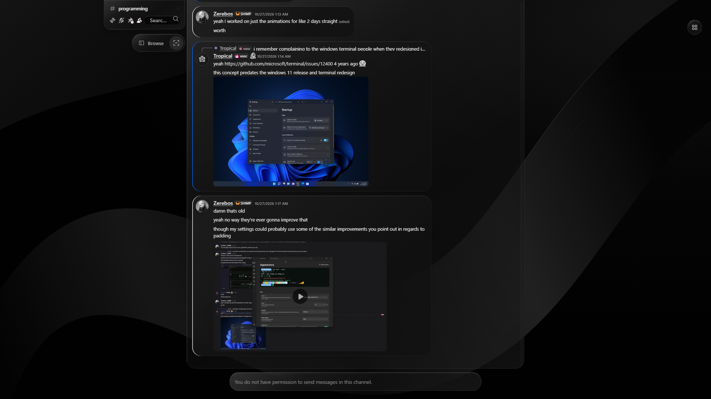
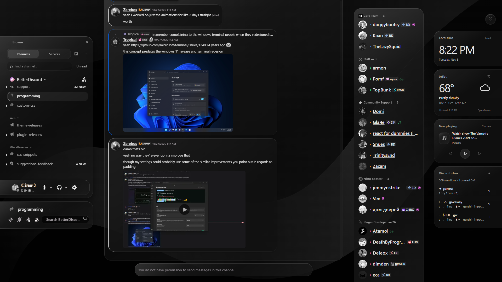
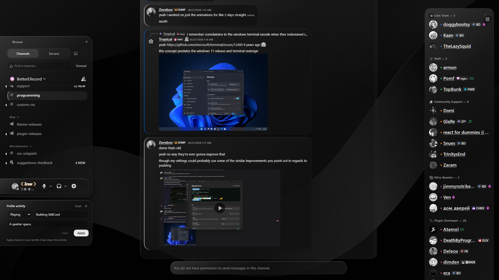
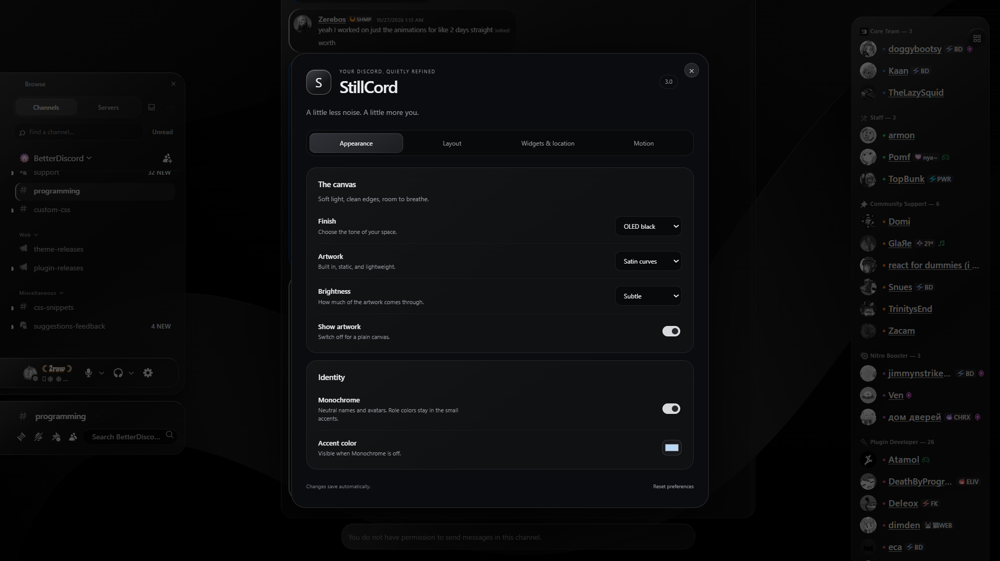
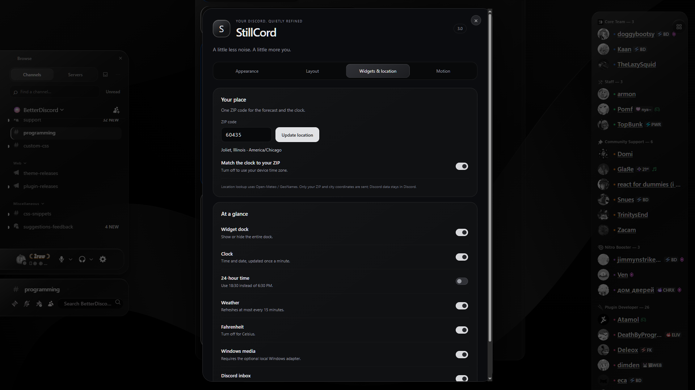

<div align="center">



**A quieter Discord. Two editions.**

OLED glass · floating navigation · connected message bubbles · useful widgets

[BetterDiscord release](https://github.com/ll2Rawll/StillCord/releases/tag/betterdiscord-v3.3.0) · [Vencord release](https://github.com/ll2Rawll/StillCord/releases/tag/vencord-v3.3.0) · [Previews](#six-ways-to-make-it-yours) · [Settings](#make-it-yours)

</div>

---

StillCord brings a minimal, glass-inspired workspace to **BetterDiscord and Vencord desktop**. A soft satin canvas, restrained highlights, and floating panels make room for the conversation. Both editions share the same visual source and include the theme.

| Your client | Download | Install |
| --- | --- | --- |
| **BetterDiscord** | [Plugin + optional media helper](https://github.com/ll2Rawll/StillCord/releases/tag/betterdiscord-v3.3.0) | Drop `StillCord.plugin.js` into Plugins. |
| **Vencord** | [Custom userplugin + optional media helper](https://github.com/ll2Rawll/StillCord/releases/tag/vencord-v3.3.0) | Add `stillCord` to `src/userplugins/` and rebuild Vencord. |

Choose the edition for your client. Vencord custom plugins require a source build; the Vencord ZIP is not a standalone installer or an official catalog plugin.

## Six ways to make it yours

These are captures of the **actual Discord desktop app running the BetterDiscord edition**, including its real channels and controls. Both editions share this visual system. The activity editor shows an unsubmitted demo draft. Open an image for the full-size view.

| Browse at your side | Just the conversation |
| :---: | :---: |
| [](docs/previews/01-browse-open.png) | [](docs/previews/02-focus.png) |
| A searchable channel list and your account controls, together. | Close Browse to let the conversation breathe. |

| A little context | Your activity, your way |
| :---: | :---: |
| [](docs/previews/03-widgets.png) | [](docs/previews/04-activity.png) |
| Time, weather, Windows media, and your Discord inbox. | A compact Playing / Listening editor beside the conversation. |

| A finish that fits | Set your place |
| :---: | :---: |
| [](docs/previews/05-settings.png) | [](docs/previews/06-location.png) |
| Tidy settings tabs, with changes saved as you go. | One US ZIP code sets the forecast and the clock’s time zone. |

## Install

### BetterDiscord

1. Install [BetterDiscord](https://betterdiscord.app/) for Discord desktop.
2. Download [**StillCord.plugin.js**](https://raw.githubusercontent.com/ll2Rawll/StillCord/main/StillCord.plugin.js). If it opens as text, save it with that exact filename.
3. In Discord, open **User Settings → BetterDiscord → Plugins → Open Plugins Folder**. Put the file there and enable **StillCord**.

**No separate theme is needed.** The artwork and styles are embedded; no remote stylesheet is loaded.

Upgrading from Still / StillSpeed? StillCord imports the previous layout preferences and disables the old Still theme and StillSpeed plugin to avoid duplicates. Keep a backup, then remove those two old addon files when you are happy with the upgrade. Existing Windows media setup continues to work.

### Vencord desktop

1. Prepare a [Vencord source build](https://docs.vencord.dev/installing/).
2. Download the [Vencord release](https://github.com/ll2Rawll/StillCord/releases/tag/vencord-v3.3.0). Put its `stillCord` folder in `Vencord/src/userplugins/`.
3. Run `pnpm install --frozen-lockfile`, then `pnpm build` in the Vencord checkout. Install that build following Vencord's guide, restart Discord, and enable **StillCord**.

[Full Vencord instructions](vencord/stillCord/README.md) · [Official custom-plugin guide](https://docs.vencord.dev/installing/custom-plugins/)

Use one client mod at a time. Each edition stores its preferences locally in its own client. Windows media is optional and the same adapter works with either edition.

## Make it yours

Open **Browse → ⋯ → StillCord settings**, or the settings button on StillCord's plugin card in either client. Vencord also exposes the panel through its Toolbox.

| Tab | What you can change |
| --- | --- |
| **Appearance** | OLED black, graphite, or light; satin curves or stars; brightness, monochrome, and accent color. |
| **Layout** | Floating layout, draggable Browse, Focus view, activity editor, and quieter navigation. |
| **Widgets & location** | Five-digit US ZIP, ZIP-based or device time, 12/24-hour clock, weather units, and individual widgets. |
| **Motion** | Reading mode, mouse-wheel smoothing, trackpad behavior, reduced motion, and lighter glass effects. |
| **Restless** | Six wallpapers, 25 effects, presets, rendering budget, light colors, and pace. |

ZIP lookup saves only after a valid result. A failed lookup keeps the last working location. The time zone comes from the selected location and follows daylight-saving changes. New installations use device time until a ZIP is set.

## Small details, considered

- **Browse** switches between channels and a searchable server directory. Drag its handle to move it; double-click to reset. **Ctrl + Alt + B** opens or closes it.
- **Connected bubbles** bring consecutive messages together, with a thin role-colored accent along their edge.
- **Reading mode** lets the glass reach the bottom while the input slides away. A vertical **Message** tab brings the input back, preserving your draft.
- **Quiet identity** uses neutral names and avatars, subtle role markers, and small game/music indicators.
- **Profile activity** is available from Browse’s More menu. **Apply** shares the activity; **Clear** removes StillCord’s custom activity. Saved drafts are not published automatically.

## Restless · the expanded collection

Open **StillCord settings → Restless** for **six original live wallpapers and 25 visual effects**. Silk, Orbit, and Aurora have been rebuilt with layered materials and light; Eclipse, Prism, and Contour add three new worlds. Adjust both light colors, wallpaper brightness, extra lighting, and pace. Restless is optional and starts off on new installs.

**Subtle**, **Expressive**, and **All out** presets set the mood in one click. Subtle keeps the artwork still, with light feedback on interaction. Four expandable groups keep every individual switch within reach. **Efficient** rendering is the default: all scene detail shares one motion layer. **Full depth** adds independent movement; **Still artwork** stops background motion.

| Detail | Motion |
| --- | --- |
| Glass light | Soft pointer lighting across the panels. |
| Liquid rims | A fine edge highlight on hovered cards. |
| Soft entrances | Menus, panels, settings, and profiles ease into place. |
| Message arrivals | New messages arrive gently without moving the conversation. |
| Halo avatars | A small lift and a fine hover halo. |
| Channel glide | Subtle feedback across channels, servers, and member rows. |
| Touch ripples | Brief, contained rings on button presses. |
| Composer aura | Soft edge light while you type. |
| Living widgets | Hover lift and a breathing media icon during playback. |
| Quiet depth | A little pointer-driven depth in the live canvas. |
| Constellations | Drifting star clusters and fine connecting lines. |
| Shooting light | Occasional silver streaks across the wallpaper. |
| Glass caustics | Slowly moving reflected light. |
| Frosted grain | A fine, still texture over the canvas. |
| Gallery lighting | Darkened edges that frame the artwork. |
| Prismatic edges | A two-tone reflection around hovered glass panels. |
| Comet cursor | Four small, fading pointer lights. |
| Magnetic icons | Icons lean toward the pointer inside their buttons. |
| Photo depth | A slight lift and tilt on hovered attachments. |
| Reaction bounce | A short spring animation on reaction emoji. |
| Unread beacons | Two gentle pulses on unread markers. |
| Writing rhythm | Three lights respond while you type locally. |
| Search lens | Illuminated search fields on focus. |
| Channel crossing | A brief sweep when navigating into a channel. |
| Reading glint | A light follows your position along the chat edge. |

Each detail has its own switch. Restless pauses when Discord is hidden, unfocused, or a video uses fullscreen. **Follow system reduced motion** is on by default; switch it off if you want Restless to animate independently of your device preference. Typed text and scroll positions stay still.

## Optional Windows media controls

The theme, navigation, clock, weather, inbox, and settings are included in both editions. Controlling Spotify, browsers, and other Windows media sessions uses a small optional local adapter.

1. Download and extract either edition's release ZIP (or this repository).
2. Install [Node.js](https://nodejs.org/) if needed.
3. Run `media/Install-Media.ps1` in PowerShell. It installs the adapter and a quiet startup shortcut for your Windows account.

The adapter listens only on `127.0.0.1` and uses a locally generated access key. Player support determines which controls are available. `media/Remove-Media.ps1` stops the service and removes its startup shortcut. The C# bridge source and build script are included.

## Lightweight by design

The default canvas is static. Efficient Restless rendering moves one prepainted artwork group, with static stars and reflections; two optional shooting lights are small separate elements. Full depth uses three moving artwork layers and independently moving stars/reflections. Still artwork has no background animation. There is no video, canvas render loop, downloaded artwork, or idle JavaScript animation loop. Pointer and reading effects run on input and fade away. Short effects are capped at ten in Efficient/Still artwork or 24 in Full depth. Timers and frames are cancelled on pause, and everything is removed on disable. Pointer work is coalesced to one update per display frame; only the hovered magnetic icon gets a transform. Permanent panels avoid live blur. Wheel easing stops after it settles; reading transitions keep Discord’s scroll viewport stable. Clock updates happen once per minute, weather is cached for 15 minutes, and widget work pauses when hidden. Discord data uses local store listeners instead of a polling loop.

Actual smoothness still depends on Discord, the device, other plugins, and media on screen. For a lower-end PC, start with **Restless → Subtle** or **Rendering → Efficient**, plus **Motion → Low power finish**. These reduce decorative work; they cannot make Discord itself faster than its hardware and native workload allow.

## Data & credits

Preferences, ZIP lookup results, and activity drafts are stored locally through BetterDiscord or Vencord's DataStore. ZIP lookup sends the ZIP to [Open-Meteo geocoding](https://open-meteo.com/en/docs/geocoding-api), powered by GeoNames. Forecast requests send city coordinates to [Open-Meteo](https://open-meteo.com/). Discord messages, member lists, and inbox data are not sent to those services. There is no analytics or telemetry service in StillCord.

StillCord is an independent, unofficial customization. Discord, BetterDiscord, Vencord, and content visible in screenshots belong to their respective owners. StillCord's code is [MIT licensed](LICENSE); Vencord keeps its own GPL license and is not redistributed in these packages.

## Development

```sh
npm ci
npm run build
npm run check
npm test
npm run package
```

`src/plugin.js`, `src/theme.css`, `src/settings.*`, `src/restless.*`, `src/wallpapers.*`, and `src/location.js` are shared by both editions. `src/betterdiscord.js` and `src/vencord/` adapt the host APIs. `scripts/build.mjs` generates `StillCord.plugin.js` and the self-contained `vencord/stillCord/` userplugin folder. Edit the sources, not generated files. esbuild is a test dependency; Python 3 packages the release ZIPs.

The release workflow validates both editions, builds and type-checks against the Vencord commit pinned in `release.json`, then publishes two separate tagged releases with checksums. Bump the version and release notes before publishing a new pair.

The release was checked for integrated-theme lifecycle, settings changes, ZIP errors and cancellation, stale lookup responses, layout controls, activity-editor behavior, compact sizing, cleanup, and idle work. Screenshots in `docs/previews/` come from Discord; test fixtures are not used as product previews.

The Vencord edition was also tested in the actual Discord desktop app without BetterDiscord: channel switching, Browse toggles, persisted preferences, ZIP weather/time, inbox, media connection, and three disable/re-enable cycles passed. Playback commands and profile activity publishing use simulated endpoints in automated tests. No fixed frame-rate or future Discord-version compatibility is promised.
